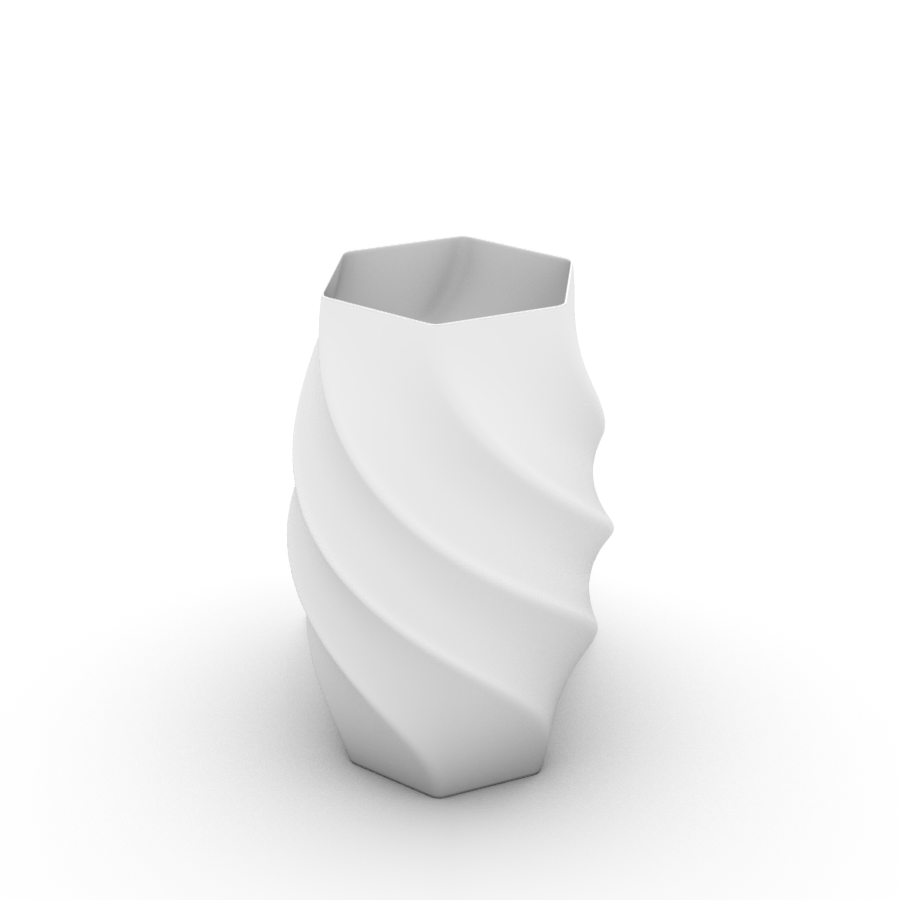
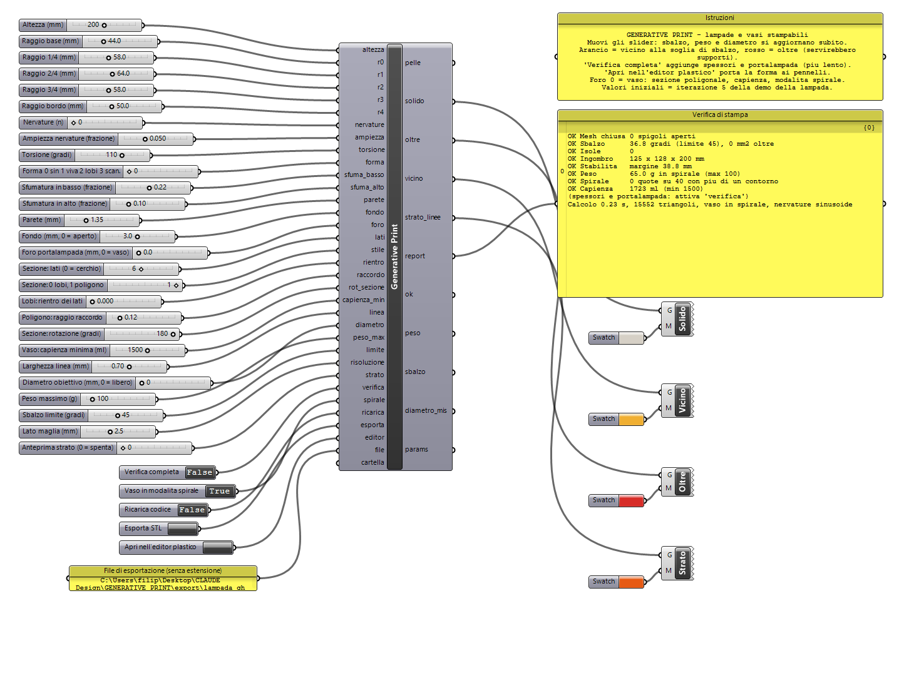

# Generative Print

Generative design per la stampa 3D dentro Rhino 8: un agente AI genera lampade e vasi da un brief, li misura, li critica e li corregge; il designer li rifinisce a mano con un editor plastico a pennelli che controlla la stampabilità mentre si modella.

| Lampada a nervature torte | Vaso esagonale in spirale |
|---|---|
|  |  |

## Cosa c'è

- **Slicer interno a Rhino**: una finestra con i parametri di stampa di ciò che hai disegnato (mesh, polisuperfici, estrusioni, SubD): stampante, materiale, strato, pareti, riempimento, supporti; controlli di stampabilità, stime di peso e tempo, mappa degli sbalzi e anteprima strato per strato. Un pulsante lancia lo slicer vero (Bambu Studio) con le stesse impostazioni, un altro apre la modifica plastica sull'oggetto.
- **Due generatori**: lampade (diffusore con foro per portalampada E27) e vasi (sezione circolare, a lobi o poligonale con spigoli raccordati, che può ruotare lungo l'altezza; fondo pieno; capienza in ml; parete vera oppure modalità spirale degli slicer, con controllo di un solo contorno per strato).
- **Ciclo chiuso** genera → verifica → critica → correggi, con un diario HTML di ogni iterazione: [`runs/2026-11-13_lampada-nervature/journal.html`](runs/2026-11-13_lampada-nervature/journal.html).
- **Editor plastico in Rhino 8** (`rhino/avvia_editor.py`): pennelli Tira/Spingi, Gonfia, Liscia, Appiattisci, Pizzica, Afferra; simmetria radiale; mappa degli sbalzi in tempo reale (giallo vicino alla soglia, rosso oltre); anteprima a strati; verifica di stampa ed esportazione STL dal pannello.
- **Definizione Grasshopper** (`grasshopper/generative_print.gh`): 20 slider per profilo, nervature, parete, fondo e portalampada; sbalzo, peso e diametro si aggiornano a ogni movimento (circa 0,9 s per una forma nuova con maglia da 2,5 mm), zone colorate in arancio (vicino alla soglia) e rosso (oltre), anteprima a strati, verifica completa, esportazione STL e un pulsante che porta la forma nell'editor plastico.
- **Verifiche di stampa** (`generative_print/checks.py`): mesh chiusa, sbalzi, isole, spessore minimo, peso, ingombro, appoggio, stabilità, sede del portalampada. Funzionano su qualunque STL.

## Demo

**Lampada.** Brief: *lampada da tavolo, diffusore a nervature torte, Ø 18 cm, PLA senza supporti, max 250 g.*
Nove iterazioni: cinque parametriche, tre di modellazione plastica e una di correzione automatica degli sbalzi (limite portato a 43° dopo il confronto con lo slicer). Oggetto finale: 225,8 g, sbalzo massimo 42,7°, spessore 1,27 mm, Ø 181,7 mm. File in [`runs/2026-11-13_lampada-nervature/final/`](runs/2026-11-13_lampada-nervature/final/) (STL, 3MF, scheda); [diario](runs/2026-11-13_lampada-nervature/journal.html).

**Vaso.** Brief: *vaso per fiori secchi a sezione esagonale torta, alto 20 cm, almeno 1,5 litri, PLA in modalità spirale, senza supporti, max 100 g.*
Tre iterazioni. Nella seconda la vista dall'alto ha mostrato che la sezione "morbida" non può avere lati diritti: il generatore è stato esteso con il poligono raccordato. Oggetto finale: 65,1 g, sbalzo massimo 36,4°, capienza 1725 ml, un solo contorno a ogni mm di altezza. File in [`runs/2026-11-13_vaso-esagonale/final/`](runs/2026-11-13_vaso-esagonale/final/); [diario](runs/2026-11-13_vaso-esagonale/journal.html).

## Uso

```bash
python -m venv .venv
.venv/Scripts/python -m pip install numpy trimesh rtree networkx lxml pytest
.venv/Scripts/python -m pytest -q tests
.venv/Scripts/python -m generative_print.verify modello.stl --params params.json
.venv/Scripts/python -m generative_print.journal runs/2026-11-13_lampada-nervature
.venv/Scripts/python -m generative_print.deliver runs/2026-11-13_vaso-esagonale 3 vaso-esagonale
.venv/Scripts/python -m generative_print.bambu runs/2026-11-13_vaso-esagonale/final/vaso-esagonale.stl runs/2026-11-13_vaso-esagonale/final/params.json
```

Confronto con uno slicer vero: `generative_print.bambu` affetta l'STL con Bambu Studio (gratuito e open source, va installato a parte) da riga di comando, con la ricetta della scheda, e legge il G-code: peso, tempo, supporti, gap infill, sbalzo del muro strato per strato e continuità della spirale. Con `--support --support-angle 45` prova se lo slicer vuole supporti.

Grasshopper: apri `grasshopper/generative_print.gh`. Il file trova da solo la cartella del progetto (deve restare in `grasshopper/`); se lo sposti, collega il percorso del progetto all'ingresso `cartella`. La definizione si rigenera con `grasshopper/build_definition.py`.



Slicer: in Rhino 8 seleziona ciò che vuoi stampare, esegui `_ScriptEditor`, apri `rhino/avvia_slicer.py` e premi F5. Pareti e riempimento nella vista sono un'anteprima geometrica; peso e tempo precisi arrivano dal pulsante «Affetta con Bambu Studio».

Editor: in Rhino 8 esegui `_ScriptEditor`, apri `rhino/avvia_editor.py` e premi F5. Lavora sulla mesh selezionata, sulla pelle generata o su una forma libera nuova. Trascina col tasto sinistro per scolpire, Ctrl per scavare, Shift per lisciare, tasto destro per ruotare la vista.

Ciclo guidato dall'agente: serve Rhino 8 con il pacchetto Rhino-MCP-Platform e il comando `MCPStart`; l'agente chiama `gp_rhino.step(doc, cartella_corsa, n, modifiche)`.

## Struttura

- `generative_print/`: nucleo in solo numpy (gira anche nel Python 3.9 di Rhino): `generators`, `checks`, `sculpt`, `slicer`, `mesh_io`, `verify`, `journal`, `deliver`, `printcheck` (analisi di un solido qualsiasi), `bambu` (confronto con lo slicer, unico modulo che lancia un programma esterno).
- `rhino/`: ponte con Rhino (`gp_rhino.py`), slicer interno (`gp_slicer.py`), editor (`gp_editor.py`), calcolo del componente Grasshopper (`gp_gh.py`).
- `grasshopper/`: definizione `.gh`, script del componente e script che la costruisce.
- `tests/`: 44 test delle misure su solidi dal risultato noto (cubi, coni, cilindri, poligoni esatti).
- `runs/`: una cartella per corsa, con parametri, STL, metriche, viste e note di ogni iterazione.

## Limiti dichiarati

- Gli oggetti della demo non sono stati stampati. Sono stati affettati in Bambu Studio (profilo X1 Carbon, ugello 0,4): il confronto è nelle schede in `final/`. Le nostre stime di tempo sono grossolane: fa fede lo slicer. La densità del PLA (1,24 g/cm³) è ipotizzata; il profilo Bambu usa 1,26.
- La critica estetica è un giudizio del modello sulle viste, non una misura.
- Nelle iterazioni 6-8 le pennellate sono state applicate dall'agente tramite script; il mouse è stato provato a parte.
- I pennelli spostano i vertici senza cambiare la topologia: niente suddivisione dinamica.
- Lampade: solo sorgenti LED.
- Vasi in spirale: la parete singola non è a tenuta d'acqua garantita; la rigidità della linea da 0,7 mm è una scelta d'esperienza, non calcolata.

## Licenza

MIT.
