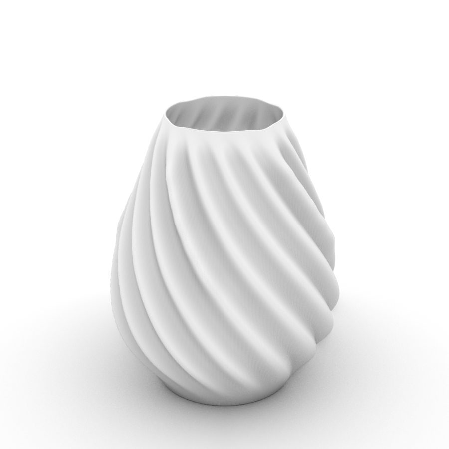

# Generative Print

Generative design per la stampa 3D dentro Rhino 8: un agente AI genera lampade e vasi da un brief, li misura, li critica e li corregge; il designer li rifinisce a mano con un editor plastico a pennelli che controlla la stampabilità mentre si modella.



## Cosa c'è

- **Ciclo chiuso** genera → verifica → critica → correggi, con un diario HTML di ogni iterazione: [`runs/2026-11-13_lampada-nervature/journal.html`](runs/2026-11-13_lampada-nervature/journal.html).
- **Editor plastico in Rhino 8** (`rhino/avvia_editor.py`): pennelli Tira/Spingi, Gonfia, Liscia, Appiattisci, Pizzica, Afferra; simmetria radiale; mappa degli sbalzi in tempo reale (giallo vicino alla soglia, rosso oltre); anteprima a strati; verifica di stampa ed esportazione STL dal pannello.
- **Verifiche di stampa** (`generative_print/checks.py`): mesh chiusa, sbalzi, isole, spessore minimo, peso, ingombro, appoggio, stabilità, sede del portalampada. Funzionano su qualunque STL.

## Demo

Brief: *lampada da tavolo, diffusore a nervature torte, Ø 18 cm, PLA senza supporti, max 250 g.*
Otto iterazioni: cinque parametriche e tre di modellazione plastica. Oggetto finale: 226,0 g, sbalzo massimo 44,5°, spessore 1,27 mm, Ø 181,7 mm. File in [`runs/2026-11-13_lampada-nervature/final/`](runs/2026-11-13_lampada-nervature/final/) (STL, 3MF, scheda).

## Uso

```bash
python -m venv .venv
.venv/Scripts/python -m pip install numpy trimesh rtree networkx lxml pytest
.venv/Scripts/python -m pytest -q tests
.venv/Scripts/python -m generative_print.verify modello.stl --params params.json
.venv/Scripts/python -m generative_print.journal runs/2026-11-13_lampada-nervature
```

Editor: in Rhino 8 esegui `_ScriptEditor`, apri `rhino/avvia_editor.py` e premi F5. Lavora sulla mesh selezionata, sulla pelle generata o su una forma libera nuova. Trascina col tasto sinistro per scolpire, Ctrl per scavare, Shift per lisciare, tasto destro per ruotare la vista.

Ciclo guidato dall'agente: serve Rhino 8 con il pacchetto Rhino-MCP-Platform e il comando `MCPStart`; l'agente chiama `gp_rhino.step(doc, cartella_corsa, n, modifiche)`.

## Struttura

- `generative_print/`: nucleo in solo numpy (gira anche nel Python 3.9 di Rhino): `generators`, `checks`, `sculpt`, `slicer`, `mesh_io`, `verify`, `journal`.
- `rhino/`: ponte con Rhino (`gp_rhino.py`) ed editor (`gp_editor.py`).
- `tests/`: 19 test delle misure su solidi dal risultato noto.
- `runs/`: una cartella per corsa, con parametri, STL, metriche, viste e note di ogni iterazione.

## Limiti dichiarati

- L'oggetto della demo non è stato stampato né aperto in uno slicer. Tempo e filo sono stime grossolane; la densità del PLA (1,24 g/cm³) è ipotizzata.
- La critica estetica è un giudizio del modello sulle viste, non una misura.
- Nelle iterazioni 6-8 le pennellate sono state applicate dall'agente tramite script; il mouse è stato provato a parte.
- I pennelli spostano i vertici senza cambiare la topologia: niente suddivisione dinamica.
- La definizione Grasshopper con slider non è ancora stata fatta.
- Lampade: solo sorgenti LED.

## Licenza

MIT.
